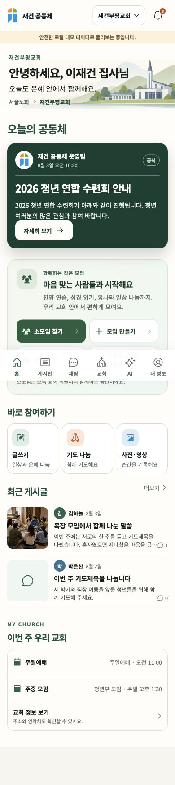
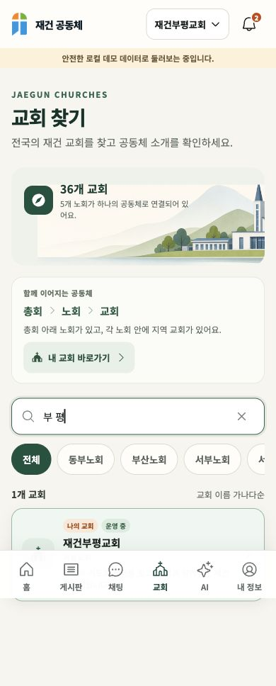
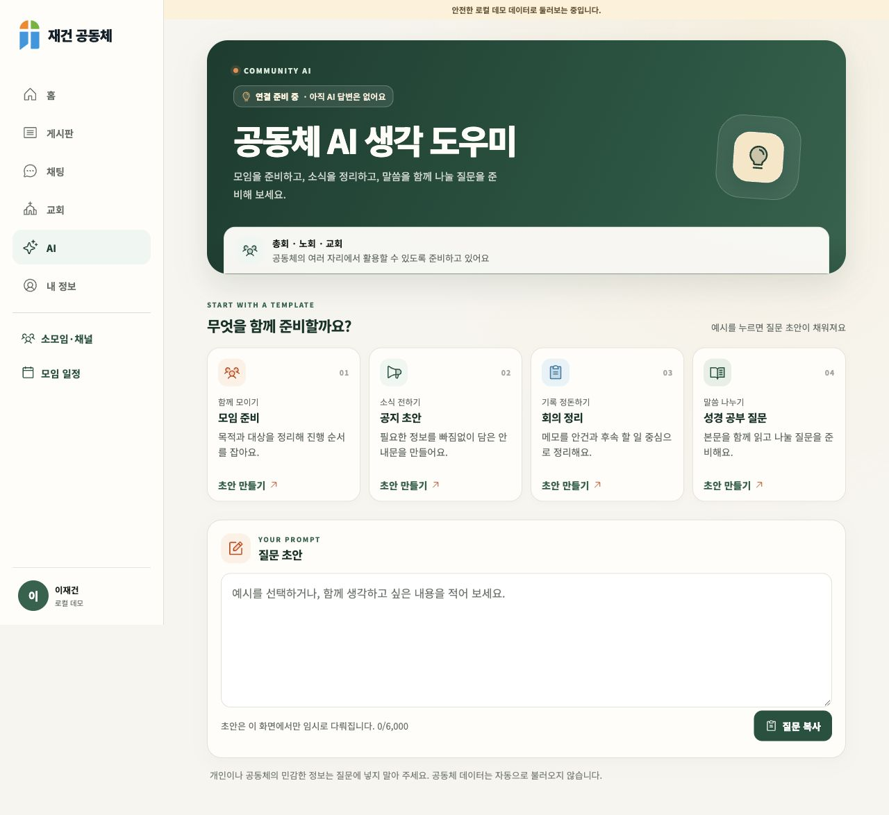

# 공동체 서비스 UI/UX·권한 점검 — 2026-10-11

## 결론과 범위

공동체 홈, 교회 탐색, AI 전용 탭을 개선하고 채널 권한·전송·읽음 처리의 확인된 결함을 수정했다. 로컬 기능·보안 회귀 검사는 통과했다. **운영 서비스 출시 승인이나 운영 DB 적용 완료를 뜻하지 않는다.**

이 문서는 초기 UI·보안 점검 당시의 기록이다. 같은 날 후속 작업에서 완료된 운영 DB 연결과 세 개의 채널 마이그레이션 적용은 [운영 연결 점검](live-connection.md)을 참고한다. 아래 미완료 항목은 해당 점검 시점 기준이며, 실제 계정의 종단 검증과 출시 승인은 여전히 별도다.

주 에이전트가 설계, 통합, 코드 검토, 브라우저 확인을 맡았다. 경량 하위 모델은 홈·교회·AI 화면과 테스트를 구현했고, 별도 보안 에이전트가 서버 권한 및 SQL 회귀 검사를 수행했다. 기존 미커밋 채널 작업은 보존하고 그 위에 수정했다.

Product Design audit 방식으로 실제 화면을 확인하고, Supabase 지침에 따라 화면의 표시 조건과 서버의 권한 검증을 분리했다. React 검토에서는 공용 메뉴·페이지 상태·늦게 도착한 응답·계정 전환을 확인했다.

브라우저 근거는 `http://127.0.0.1:5176`의 **명시적으로 표시된 로컬 데모**다. 운영 개인정보를 사용하거나 외부 AI에 데이터를 보내지 않았다. 지정 브라우저 도구의 실행 파일이 없어 사용 가능한 인앱 브라우저 제어로 검증했다.

## 유지한 중요한 구분

| 구분 | 의미와 권한 경계 |
| --- | --- |
| 총회 → 노회 → 교회 | 조직 계층이다. 상위·하위 조직의 권한을 자동 상속하지 않는다. |
| 사역자 | 소속 교회 회원 승인과 목회 운영 중심이다. 사역자라는 이유만으로 모든 조직 임원 관리 권한을 얻지 않는다. |
| 임원 역할 / 연도별 직책 | 기본 임원 권한과 회장·부회장·총무·서기·회계 직책은 별개다. 회의록·회계 권한도 서버가 확인한다. |
| 부서 임원 | 장년부·청년부·청소년부·초등부의 연도별 기록이다. 교회 전체 승인·회계 권한을 주지 않는다. |
| 소모임·채널 관리자 | 해당 채널 운영만 담당한다. 교회·노회·총회 관리자가 되지 않는다. 채널은 현재 같은 교회의 승인·동의 완료 회원 범위다. |
| AI | 현재 질문 템플릿·초안·복사 화면이다. 명단·대화·회계 자동 조회나 답변 생성, 자율 승인·게시 기능은 없다. |

기존 다섯 공용 메뉴에 사용자가 요청한 AI를 여섯 번째 항목으로 추가했다. 관리 화면은 사역자·임원의 기존 전용 메뉴를 유지하고 공용 소모임·일정·AI로 이동하는 링크만 추가했다.

## 직접 확인한 화면 흐름

### 1. 성도 홈 → 소모임 진입 — 개선 완료

교회 인사와 공식 소식의 우선순위를 유지하면서 소속 노회·교회, 소모임 찾기·만들기·일정·AI를 한 곳에 배치했다. 일반 성도 홈에는 회원 승인이나 회계 작업을 추가하지 않았다. 모임 만들기는 `?create=1`로 비공개 기본값의 생성 폼을 연다. 실제 서버 채널은 데모에서 사용 불가라고 명시한다.

### 2. 교회 찾기 → 내 교회 → 게시판·소모임·일정 — 개선 완료

총회·노회·교회 관계를 설명하고 내 교회 바로가기를 추가했다. 노회 개수는 데이터에서 계산하며 교회 이름은 실제 가나다순으로 정렬한다. `부 평`처럼 공백이 있는 검색도 `재건부평교회` 한 건을 반환하는 것을 브라우저에서 확인했다. 내 교회 상세의 소통 링크는 본인 소속 교회에만 나타나며, 이 변경으로 회원 명단 공개 범위를 넓히지 않았다. 직접 상세 URL에 들어온 경우 뒤로 버튼은 교회 목록으로 돌아간다.

### 3. AI 탭 → 템플릿 → 초안 수정·교체 확인 — 연결 전 화면 완료

모임 준비·공지 초안·회의 정리·성경 공부 질문을 제공한다. 작성한 초안이 있으면 다른 템플릿으로 덮어쓰기 전에 묻는다. 템플릿 선택 후 입력창으로 초점이 이동하고 Tab으로 복사 버튼에 도달하는 것을 확인했다. 모바일에도 ‘아직 AI 답변은 없어요’를 표시한다. 입력창은 16px, 주요 조작 버튼은 최소 44px이다.

초안은 최대 6,000자이고 브라우저 메모리에만 남는다. 새로고침·페이지 이탈·계정 변경 시 지속 저장하지 않는다. 계정 전환 시 이전 초안이 사라지는 회귀 검사를 추가했다. API는 연결하지 않았다.

[AI 모바일 화면](ai-mobile.png) · [AI 태블릿 화면](ai-tablet.png)

브라우저 크기 320×720, 390×844, 768×1024, 1280×900에서 확인했다. 320px에서 새로고침 후 메뉴가 두 줄로 밀리는 CSS 우선순위 문제를 발견해 수정했다. 수정 후 여섯 탭이 한 줄이며 각 탭은 약 51×61px, 가로 스크롤 너비는 화면 너비와 같았다. 검증한 탭의 콘솔 경고·오류는 없었다. 전체 페이지 캡처의 고정 하단 메뉴는 촬영 당시 화면 위치에 한 번 나타난다.

## 심각도순 수정 내역

| 위험도 | 확인된 문제 | 수정 및 근거 |
| --- | --- | --- |
| 높음 | 차단·비활성·숨김 처리된 메시지의 ID나 첨부 경로로 전달·반응·스레드·파일 접근을 다시 시도할 수 있는 검사 불일치 | 서버 공통 메시지 가시성 검사를 적용하고 Storage 정책도 새 검사에 다시 연결. 새 SQL 회귀 검사에 차단 원문·숨김 첨부·탈퇴 작성자·알림 접근 포함. |
| 높음 | 전송은 완료됐지만 응답을 잃었을 때 첨부를 삭제하거나 재업로드할 수 있음 | 결과 불명 상태는 원래 메시지 ID·첨부·태그를 보존해 재확인. 서버가 전체 payload 일치를 검사. 전송 시작 전 실패만 임시 업로드 정리. |
| 높음 | 메시지 삭제 응답 손실 시 첨부 정리 경로를 다시 받지 못함 | 서버가 본인 삭제 결과를 저장해 재시도에도 동일 경로를 반환. |
| 보통 | 반응 토글을 응답 지연 후 재시도하면 이미 반영된 반응이 취소됨 | 새 클라이언트는 원하는 `active` 상태를 전달. 반복 요청 결과가 동일하고 잘못된 타입·이모지는 거절. 기존 클라이언트와 호환 유지. |
| 보통 | 답글 미읽음을 본문 커서로 계산해 읽지 않은 답글이 사라지거나 읽은 상태가 남음 | 답글별 읽음 커서, 미읽은 답글 수, 서버 확인 후 화면 갱신. 삭제된 원문은 기존 답글만 읽을 수 있음. |
| 보통 | 읽음 갱신마다 실시간 이벤트가 다시 발생 | 읽음·개인 알림 설정 변경은 공동체 이벤트에서 제외. 채널 삭제 후 남는 잘못된 이벤트도 방지. |
| 보통 | 스레드 실패가 무한 로딩처럼 보이고 초안을 닫으면 사라짐 | 실패·재시도·이전/최근 답글 이동 및 같은 화면 안의 스레드별 초안 보존. 30초 대체 갱신은 열린 스레드도 포함. |
| 보통 | 계정·동의 전환 직전 시작한 서명 URL 요청이 캐시를 다시 채울 수 있음 | 캐시 세대 검사와 페이지 종료 시 캐시 폐기. 스레드 응답의 계정·채널·원문 ID를 정확히 확인. |
| 보통 | 좁은 화면에서 공용 메뉴가 두 줄로 밀림 | 여섯 열 규칙의 우선순위를 고정하고 320px에서 실제 재확인. |

## 최종 검증 결과

- [x] 웹 전체: **41개 파일, 275개 테스트 통과**.
- [x] 채널 UI/API: **33개 테스트 통과**.
- [x] 로컬 DB: **13개 파일, 766개 테스트 통과**. 이번 보안 파일에는 45개 검사 포함.
- [x] TypeScript 검사와 운영용 웹 빌드 통과. 운영 번들에 데모 인물·데이터가 포함되지 않음을 확인.
- [x] 비밀정보 검사, 동의 문서 해시 7개 검사, SQL 마이그레이션 23개 검사 통과.
- [x] Edge Function 보안 검사 **34개 통과**.
- [x] 로컬 DB 보안 검사 경고 없음.
- [x] 보호된 기존 모바일 런타임 28개 파일 무결성 및 `git diff --check` 통과.

최종 실행 명령은 루트의 `npm run test:web`, `npm run typecheck:web`, `npm run build:web`, `npm run test:security-static`, `npm run check:runtime`, 로컬 Supabase의 `test db --local`, `db advisors --local --type security --level warn --fail-on error`이다.

## 운영 반영 전 남은 조건

- [ ] 운영 DB의 마이그레이션 이력을 대조하고 미적용 SQL을 순서대로 적용한다. 새 화면은 두 채널 마이그레이션을 적용한 서버 계약을 요구한다: `20260913022919_channel_realtime_threads_notifications.sql`, `20261011043227_channel_visibility_read_integrity.sql`.
- [ ] 이번 검증은 기존 로컬 DB에 SQL을 직접 적용했다. 로컬 마이그레이션 이력은 조작하지 않았고 DB 초기화도 하지 않았다. 후속 자동 마이그레이션 전에 실제 스키마와 이력을 대조해야 한다.
- [ ] 운영 또는 스테이징의 실제 두 계정으로 채널 초대→수락→대화→답글→차단→첨부 접근을 브라우저에서 재검증한다. 이번 채널 검증은 자동 UI 검사와 실제 로컬 DB 권한 검사이며 운영 브라우저 E2E는 아니다.
- [ ] 300명 동시 접속·대규모 대화 이력·실제 이동통신망·실기기·화면 읽기 도구 검증은 별도다. 이번 결과로 부하 수용량이나 완전한 접근성 준수를 보증하지 않는다.
- [ ] 14세 미만 가입은 기존대로 허용하지 않는다. 모든 연령으로 확대하려면 검증 가능한 보호자 동의·철회·보호 정책을 별도로 설계해야 한다.
- [ ] AI 공급자·서버 인증·비용 제한·개인정보 고지 검토 후 API를 연결한다. 구체적인 경계는 `docs/architecture/ai-assistant-integration.md`에 정리했다.
- [ ] Git 커밋·푸시, 운영 배포, App Store 제출은 이번 작업에서 수행하지 않았다.

기존 첨부의 서명 URL 만료에 따른 최대 60초 회수 지연은 유지된다. 일반 문서·압축파일의 업로드 및 미디어 스캐너/변환 파이프라인도 이번에 활성화하지 않았다.
